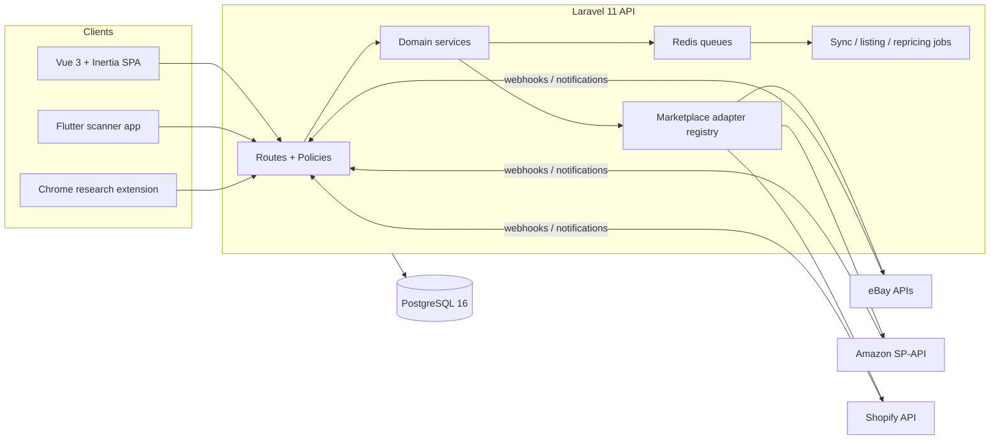

# FlipStack

[](https://github.com/heathlanders/flipstack/actions/workflows/tests.yml)

Multi-tenant operations platform for reselling businesses — inventory, marketplace listings, repricing, fulfillment, and analytics on one Laravel backend, with a Vue 3 web app and a Flutter warehouse scanner.

> **Live demo:** _coming soon at [flipstack.app](https://flipstack.app) — read-only demo accounts for each role._

<!-- hero screenshot: docs/images/dashboard.png -->

## Why it exists

FlipStack was built for a real reselling business that ran a six-figure eBay operation out of spreadsheets, a listing tool, a shipping app, and a lot of copy-paste. It replaced that stack with one system: products come in through a barcode-scan intake pipeline, get enriched and listed to marketplaces, are tracked on physical warehouse shelves, and flow out through fulfillment — with every step visible to the team roles that own it. The SKU-parsing importer alone onboarded a 66k-listing eBay store, reconstructing the product catalog, supplier/consignor records, and warehouse locations from freeform custom labels.

## Scale

| | |
|---|---|
| Backend | Laravel 11 (PHP 8.2), PostgreSQL 16, Redis queues |
| Frontend | Vue 3 + Inertia.js + Tailwind |
| Mobile | Flutter warehouse scanner app (same API) |
| Models | 128 Eloquent models |
| Database | 148 tables |
| Routes | 971 registered routes |
| Tests | 1,021 test methods across 96 files |
| Marketplaces | eBay, Amazon (SP-API), Shopify |
| Design docs | 180 documents in [`docs/`](docs/) |

## Architecture



## Three places to look first

**Marketplace adapter registry** — every marketplace implements one adapter contract; sync behavior is declarative per-marketplace config, so adding a channel doesn't touch core inventory code. See [`config/marketplaces.php`](config/marketplaces.php), [`app/Services/MarketplaceRegistry.php`](app/Services/MarketplaceRegistry.php), and the rule engine in [`app/Services/MarketplaceSyncRuleEngine.php`](app/Services/MarketplaceSyncRuleEngine.php).

**eBay integration surface** — OAuth token lifecycle, Browse/Finding/Sell/Inventory APIs, a rate limiter, business-policy rules, and a store importer that parses freeform SKUs into products, consignors, and warehouse bins. Start at [`app/Services/EbayOAuthService.php`](app/Services/EbayOAuthService.php), [`app/Services/EbayStoreImportService.php`](app/Services/EbayStoreImportService.php), and [`docs/EBAY_SYNC_AND_UPDATE_SYSTEM.md`](docs/EBAY_SYNC_AND_UPDATE_SYSTEM.md).

**Barcode intake pipeline** — scan a UPC on the Flutter app → lookup → AI-assisted enrichment → research queue → listing draft, orchestrated through Redis queues. See [`app/Services/ProductResearchOrchestrator.php`](app/Services/ProductResearchOrchestrator.php), [`app/Http/Controllers/Product/IntakeQueueController.php`](app/Http/Controllers/Product/IntakeQueueController.php), and [`mobile/`](mobile/).

## Screenshots

<!-- docs/images/: dashboard, inventory, product detail, eBay sync, repricing rules, analytics, Flutter scanner -->
_Screenshots coming with the live demo._

## Run it locally

Requires Docker, Node 18+, and npm on the host.

```bash
cp .env.example .env
docker compose up -d --build
docker exec ecommerce_app composer install
docker exec ecommerce_app php artisan key:generate
docker exec ecommerce_app php artisan migrate --seed
docker exec ecommerce_app php artisan storage:link
npm install && npm run dev
```

App runs at http://localhost:8090 — seeded logins are listed in [`docs/SETUP.md`](docs/SETUP.md). Full setup detail (pgAdmin, queues, mobile builds) lives there too.

Run the tests:

```bash
docker exec ecommerce_app php artisan test
```

## User roles

| Role | Description |
|------|-------------|
| Owner | Full organization access |
| Buyer | Purchase and intake products |
| Lister | Create and manage listings |
| Fulfillment | Process and ship orders |

## About this repository

This is a point-in-time public snapshot of a private repository with ~6 months of history (600+ conventional commits); the history was squashed to scrub client data before publishing. The platform was built solo, working from the day-to-day needs of a real reselling operation.

## License

[MIT](LICENSE)
