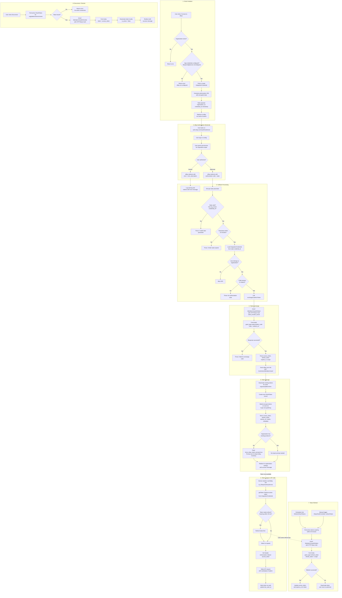

# eBay OAuth 2.0 Authorization Code Flow

Visual workflow of the eBay OAuth integration as implemented in this application.

## Flow Diagram

## Key Files

| File | Role |
|------|------|
| `app/Http/Controllers/Integration/IntegrationController.php` | OAuth initiation, credential creation |
| `app/Http/Controllers/Ebay/EbayOAuthController.php` | Callback, manual refresh, disconnect |
| `app/Services/EbayOAuthService.php` | Token exchange, refresh, revoke logic |
| `app/Services/EbayConfigService.php` | App-level credential config (client_id, secret, RuName) |
| `app/Models/Integration/OAuthToken.php` | Token model with auto-encryption |
| `app/Models/Integration/IntegrationCredential.php` | Credential model, auth URL generation |
| `app/Jobs/RefreshOAuthTokens.php` | Scheduled job for automatic token refresh |
| `app/Services/EbayInventoryService.php` | Example of token usage in API calls |

## OAuth Scopes Requested

- `sell.inventory` - Manage inventory
- `sell.fulfillment` - Manage orders/fulfillment
- `sell.account` - Manage account settings
- `sell.marketing` - Marketing tools
- `sell.analytics.readonly` - Read analytics
- `sell.finances` - Financial data
- `sell.payment.dispute` - Payment disputes
- `commerce.identity.readonly` - Read user identity

## Security Details

- **State parameter**: Encrypted with Laravel's `encrypt()`, contains org_id, credential_id, and timestamp
- **State expiry**: 10-minute window enforced on callback
- **Token storage**: Access and refresh tokens encrypted at rest via `Crypt::encryptString` in model boot
- **Token refresh threshold**: Tokens are refreshed when expiring within 30 minutes
- **App-level credentials**: Client ID, secret, and RuName come from environment config, not user input
- **HTTP Basic Auth**: Token exchange, refresh, and revoke all use `client_id:client_secret` as Basic Auth credentials
