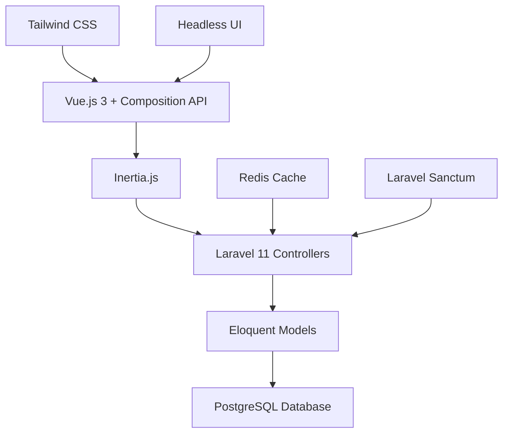
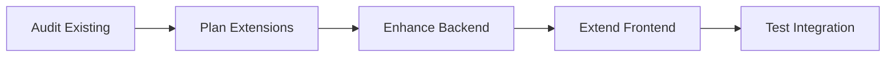
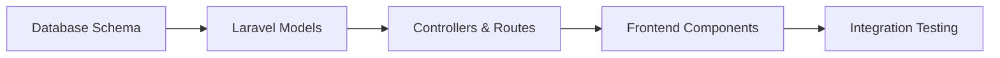

# Supplier Frontend Implementation Guide
## Complete Infrastructure Analysis & Development Roadmap

[](https://laravel.com)
[](https://vuejs.org)
[](https://inertiajs.com)
[](https://postgresql.org)
[](https://tailwindcss.com)

---

## 📋 Table of Contents

- [Overview](#-overview)
- [Prerequisites](#-prerequisites)
- [Phase 1: Infrastructure Analysis](#-phase-1-infrastructure-analysis)
- [Phase 2: Analysis Results Interpretation](#-phase-2-analysis-results-interpretation)
- [Phase 3: Implementation Planning](#-phase-3-implementation-planning)
- [Phase 4: Backend Development](#-phase-4-backend-development)
- [Phase 5: Frontend Development](#-phase-5-frontend-development)
- [Phase 6: Testing & Optimization](#-phase-6-testing--optimization)
- [Troubleshooting Guide](#-troubleshooting-guide)
- [Best Practices](#-best-practices)

---

## 🎯 Overview

This guide provides a complete roadmap for implementing supplier management functionality in your Laravel 11 + Vue.js 3 e-commerce SaaS platform. The process is divided into systematic phases, starting with infrastructure analysis and progressing through full implementation.

### What You'll Build

- **Supplier Management System**: Complete CRUD operations for suppliers
- **Purchase Order Management**: Creation and tracking of purchase orders  
- **Product-Supplier Relationships**: Link products to suppliers with pricing
- **Invoice Tracking**: Monitor supplier invoices and payments
- **Analytics Dashboard**: Supplier performance metrics and reporting
- **Responsive Frontend**: Mobile-first Vue.js interface with dark mode

### Architecture Stack



---

## 🔧 Prerequisites

### Environment Requirements
- **Docker & Docker Compose** installed and running
- **Laravel 11** application with Jetstream
- **PostgreSQL 16** database (port 5433)
- **Redis 7** for caching and sessions (port 6380)
- **Node.js** for frontend build tools

### Current Setup Verification
```bash
# Verify your current setup
docker compose ps
docker compose exec app php artisan --version
docker compose exec app php artisan migrate:status
```

Expected containers:
- `ecommerce_app` - PHP application
- `ecommerce_db` - PostgreSQL database  
- `ecommerce_web` - Nginx web server
- `ecommerce_redis` - Redis cache/queue

---

## 📊 Phase 1: Infrastructure Analysis

The first critical step is understanding your current infrastructure. This analysis will determine your implementation approach.

### Step 1.1: Download Analysis Scripts

Create the following scripts in your Laravel project root:

#### 📄 `analyze-database.php`
```php
<?php

/**
 * Database Structure Analysis Script
 * Analyzes existing database tables, columns, relationships, and indexes
 */

use Illuminate\Support\Facades\DB;
use Illuminate\Support\Facades\Schema;

class DatabaseAnalyzer
{
    private $output = [];
    private $supplierRelatedTables = [];
    
    public function analyze()
    {
        $this->output[] = "=== DATABASE STRUCTURE ANALYSIS ===";
        $this->output[] = "Generated: " . now()->format('Y-m-d H:i:s');
        $this->output[] = "Database: " . config('database.connections.pgsql.database');
        $this->output[] = "";
        
        // Get all tables
        $tables = $this->getAllTables();
        $this->output[] = "TOTAL TABLES FOUND: " . count($tables);
        $this->output[] = "";
        
        // Analyze each table
        foreach ($tables as $table) {
            $this->analyzeTable($table);
            
            // Check if table is supplier-related
            if ($this->isSupplierRelated($table)) {
                $this->supplierRelatedTables[] = $table;
            }
        }
        
        // Analyze supplier-related tables
        $this->analyzeSupplierTables();
        
        // Check for common e-commerce tables
        $this->checkCommonEcommerceTables($tables);
        
        // Analyze relationships
        $this->analyzeTableRelationships();
        
        return implode("\n", $this->output);
    }
    
    private function getAllTables()
    {
        $query = "SELECT tablename FROM pg_tables WHERE schemaname = 'public' ORDER BY tablename";
        $results = DB::select($query);
        return array_column($results, 'tablename');
    }
    
    private function analyzeTable($table)
    {
        $this->output[] = "TABLE: {$table}";
        $this->output[] = str_repeat("-", 50);
        
        // Get column information
        $columns = $this->getTableColumns($table);
        $this->output[] = "Columns (" . count($columns) . "):";
        
        foreach ($columns as $column) {
            $nullable = $column->is_nullable ? 'NULL' : 'NOT NULL';
            $default = $column->column_default ? "DEFAULT: {$column->column_default}" : '';
            $this->output[] = sprintf("  %-20s %-15s %-10s %s", 
                $column->column_name, 
                $column->data_type, 
                $nullable, 
                $default
            );
        }
        
        // Get indexes
        $indexes = $this->getTableIndexes($table);
        if (!empty($indexes)) {
            $this->output[] = "Indexes:";
            foreach ($indexes as $index) {
                $unique = $index->is_unique ? 'UNIQUE' : '';
                $this->output[] = sprintf("  %-25s %-10s %s", 
                    $index->indexname, 
                    $unique, 
                    $index->indexdef
                );
            }
        }
        
        // Get row count
        try {
            $count = DB::table($table)->count();
            $this->output[] = "Row Count: {$count}";
        } catch (\Exception $e) {
            $this->output[] = "Row Count: Error - " . $e->getMessage();
        }
        
        $this->output[] = "";
    }
    
    private function getTableColumns($table)
    {
        $query = "
            SELECT column_name, data_type, is_nullable, column_default, character_maximum_length
            FROM information_schema.columns 
            WHERE table_name = ? AND table_schema = 'public'
            ORDER BY ordinal_position
        ";
        return DB::select($query, [$table]);
    }
    
    private function getTableIndexes($table)
    {
        $query = "
            SELECT indexname, indexdef, 
                   CASE WHEN indisunique THEN true ELSE false END as is_unique
            FROM pg_indexes 
            JOIN pg_class ON pg_class.relname = pg_indexes.tablename
            JOIN pg_index ON pg_index.indexrelid = pg_class.oid
            WHERE tablename = ? AND schemaname = 'public'
        ";
        return DB::select($query, [$table]);
    }
    
    private function isSupplierRelated($table)
    {
        $supplierKeywords = ['supplier', 'vendor', 'purchase', 'invoice'];
        
        foreach ($supplierKeywords as $keyword) {
            if (stripos($table, $keyword) !== false) {
                return true;
            }
        }
        
        return false;
    }
    
    private function analyzeSupplierTables()
    {
        $this->output[] = str_repeat("=", 60);
        $this->output[] = "SUPPLIER-RELATED TABLES ANALYSIS";
        $this->output[] = str_repeat("=", 60);
        
        if (empty($this->supplierRelatedTables)) {
            $this->output[] = "❌ NO SUPPLIER-RELATED TABLES FOUND";
            $this->output[] = "You will need to create supplier infrastructure from scratch.";
            $this->output[] = "";
            return;
        }
        
        $this->output[] = "✅ FOUND " . count($this->supplierRelatedTables) . " SUPPLIER-RELATED TABLES:";
        foreach ($this->supplierRelatedTables as $table) {
            $this->output[] = "  - {$table}";
        }
        $this->output[] = "";
        
        // Check for expected supplier tables
        $expectedTables = [
            'suppliers' => 'Main supplier information table',
            'supplier_products' => 'Supplier-product relationship table',
            'purchase_orders' => 'Purchase order management',
            'purchase_order_items' => 'Purchase order line items',
            'supplier_invoices' => 'Invoice tracking',
            'supplier_contacts' => 'Supplier contact information'
        ];
        
        $this->output[] = "EXPECTED SUPPLIER TABLES CHECK:";
        foreach ($expectedTables as $table => $description) {
            $exists = in_array($table, $this->supplierRelatedTables) ? '✅' : '❌';
            $this->output[] = "  {$exists} {$table} - {$description}";
        }
        $this->output[] = "";
    }
    
    private function checkCommonEcommerceTables($tables)
    {
        $this->output[] = str_repeat("=", 60);
        $this->output[] = "COMMON E-COMMERCE TABLES CHECK";
        $this->output[] = str_repeat("=", 60);
        
        $commonTables = [
            'users' => 'User authentication',
            'products' => 'Product catalog',
            'categories' => 'Product categories',
            'orders' => 'Customer orders',
            'order_items' => 'Order line items',
            'inventory' => 'Stock management',
            'customers' => 'Customer information',
            'payments' => 'Payment tracking',
            'teams' => 'Jetstream teams',
            'team_user' => 'Team membership',
            'migrations' => 'Laravel migrations'
        ];
        
        foreach ($commonTables as $table => $description) {
            $exists = in_array($table, $tables) ? '✅' : '❌';
            $this->output[] = "  {$exists} {$table} - {$description}";
        }
        $this->output[] = "";
    }
    
    private function analyzeTableRelationships()
    {
        $this->output[] = str_repeat("=", 60);
        $this->output[] = "FOREIGN KEY RELATIONSHIPS";
        $this->output[] = str_repeat("=", 60);
        
        $query = "
            SELECT
                tc.table_name,
                kcu.column_name,
                ccu.table_name AS foreign_table_name,
                ccu.column_name AS foreign_column_name,
                tc.constraint_name
            FROM
                information_schema.table_constraints AS tc
                JOIN information_schema.key_column_usage AS kcu
                  ON tc.constraint_name = kcu.constraint_name
                  AND tc.table_schema = kcu.table_schema
                JOIN information_schema.constraint_column_usage AS ccu
                  ON ccu.constraint_name = tc.constraint_name
                  AND ccu.table_schema = tc.table_schema
            WHERE tc.constraint_type = 'FOREIGN KEY'
            ORDER BY tc.table_name, kcu.column_name;
        ";
        
        $relationships = DB::select($query);
        
        if (empty($relationships)) {
            $this->output[] = "❌ NO FOREIGN KEY RELATIONSHIPS FOUND";
            $this->output[] = "Consider adding foreign key constraints for data integrity.";
        } else {
            $this->output[] = "✅ FOUND " . count($relationships) . " FOREIGN KEY RELATIONSHIPS:";
            $this->output[] = "";
            
            foreach ($relationships as $rel) {
                $this->output[] = sprintf("  %s.%s -> %s.%s (%s)",
                    $rel->table_name,
                    $rel->column_name,
                    $rel->foreign_table_name,
                    $rel->foreign_column_name,
                    $rel->constraint_name
                );
            }
        }
        $this->output[] = "";
    }
}

// Execute the analysis
try {
    $analyzer = new DatabaseAnalyzer();
    $report = $analyzer->analyze();
    echo $report;
    
    // Save to file
    file_put_contents(__DIR__ . '/database-analysis-report.txt', $report);
    echo "\n\nReport saved to: database-analysis-report.txt\n";
    
} catch (\Exception $e) {
    echo "Error analyzing database: " . $e->getMessage() . "\n";
    echo "Stack trace: " . $e->getTraceAsString() . "\n";
}
```

#### 📄 `analyze-laravel.php`
```php
<?php

/**
 * Laravel Infrastructure Analysis Script
 * Analyzes existing models, controllers, routes, middleware, and other Laravel components
 */

class LaravelAnalyzer
{
    private $output = [];
    private $appPath;
    private $supplierRelatedFiles = [];
    
    public function __construct()
    {
        $this->appPath = app_path();
    }
    
    public function analyze()
    {
        $this->output[] = "=== LARAVEL INFRASTRUCTURE ANALYSIS ===";
        $this->output[] = "Generated: " . now()->format('Y-m-d H:i:s');
        $this->output[] = "Laravel Version: " . app()->version();
        $this->output[] = "App Path: " . $this->appPath;
        $this->output[] = "";
        
        // Analyze different components
        $this->analyzeModels();
        $this->analyzeControllers();
        $this->analyzeMiddleware();
        $this->analyzeFormRequests();
        $this->analyzeRoutes();
        $this->analyzePolicies();
        $this->analyzeJobs();
        $this->analyzeSupplierRelatedFiles();
        
        return implode("\n", $this->output);
    }
    
    private function analyzeModels()
    {
        $this->output[] = str_repeat("=", 60);
        $this->output[] = "ELOQUENT MODELS ANALYSIS";
        $this->output[] = str_repeat("=", 60);
        
        $modelsPath = $this->appPath . '/Models';
        $models = $this->getPhpFiles($modelsPath);
        
        $this->output[] = "Total Models: " . count($models);
        $this->output[] = "";
        
        foreach ($models as $model) {
            $this->analyzeModel($model);
        }
        
        // Check for expected e-commerce models
        $this->checkExpectedModels($models);
    }
    
    private function analyzeModel($modelFile)
    {
        $modelName = pathinfo($modelFile, PATHINFO_FILENAME);
        $this->output[] = "MODEL: {$modelName}";
        $this->output[] = str_repeat("-", 30);
        
        $content = file_get_contents($modelFile);
        
        // Check if supplier-related
        if ($this->isSupplierRelated($modelName)) {
            $this->supplierRelatedFiles[] = $modelFile;
            $this->output[] = "🎯 SUPPLIER-RELATED MODEL";
        }
        
        // Extract class information
        $this->analyzeModelContent($content, $modelName);
        $this->output[] = "";
    }
    
    private function analyzeModelContent($content, $modelName)
    {
        // Check for relationships
        $relationships = $this->extractRelationships($content);
        if (!empty($relationships)) {
            $this->output[] = "Relationships:";
            foreach ($relationships as $relationship) {
                $this->output[] = "  - {$relationship}";
            }
        }
        
        // Check for fillable properties
        if (preg_match('/protected\s+\$fillable\s*=\s*\[(.*?)\]/s', $content, $matches)) {
            $fillable = str_replace(["\n", " ", "'", '"'], '', $matches[1]);
            $this->output[] = "Fillable: [{$fillable}]";
        }
        
        // Check for hidden properties
        if (preg_match('/protected\s+\$hidden\s*=\s*\[(.*?)\]/s', $content, $matches)) {
            $hidden = str_replace(["\n", " ", "'", '"'], '', $matches[1]);
            $this->output[] = "Hidden: [{$hidden}]";
        }
        
        // Check for casts
        if (preg_match('/protected\s+\$casts\s*=\s*\[(.*?)\]/s', $content, $matches)) {
            $this->output[] = "Has Casts: Yes";
        }
        
        // Check for traits
        $traits = $this->extractTraits($content);
        if (!empty($traits)) {
            $this->output[] = "Traits: " . implode(', ', $traits);
        }
        
        // Check for accessors and mutators
        $accessors = $this->extractAccessors($content);
        $mutators = $this->extractMutators($content);
        if (!empty($accessors)) {
            $this->output[] = "Accessors: " . implode(', ', $accessors);
        }
        if (!empty($mutators)) {
            $this->output[] = "Mutators: " . implode(', ', $mutators);
        }
    }
    
    private function extractRelationships($content)
    {
        $relationships = [];
        $relationshipMethods = ['hasOne', 'hasMany', 'belongsTo', 'belongsToMany', 'morphTo', 'morphMany', 'morphOne'];
        
        foreach ($relationshipMethods as $method) {
            if (preg_match_all('/function\s+(\w+)\s*\([^)]*\).*?return\s+\$this->' . $method . '/s', $content, $matches)) {
                foreach ($matches[1] as $relationName) {
                    $relationships[] = "{$relationName}() -> {$method}";
                }
            }
        }
        
        return $relationships;
    }
    
    private function extractTraits($content)
    {
        $traits = [];
        if (preg_match_all('/use\s+([\w\\\\]+);/', $content, $matches)) {
            foreach ($matches[1] as $trait) {
                if (strpos($trait, '\\') !== false) {
                    $traits[] = $trait;
                }
            }
        }
        return $traits;
    }
    
    private function extractAccessors($content)
    {
        $accessors = [];
        if (preg_match_all('/function\s+get(\w+)Attribute/', $content, $matches)) {
            $accessors = $matches[1];
        }
        return $accessors;
    }
    
    private function extractMutators($content)
    {
        $mutators = [];
        if (preg_match_all('/function\s+set(\w+)Attribute/', $content, $matches)) {
            $mutators = $matches[1];
        }
        return $mutators;
    }
    
    private function analyzeControllers()
    {
        $this->output[] = str_repeat("=", 60);
        $this->output[] = "CONTROLLERS ANALYSIS";
        $this->output[] = str_repeat("=", 60);
        
        $controllersPath = $this->appPath . '/Http/Controllers';
        $controllers = $this->getPhpFilesRecursive($controllersPath);
        
        $this->output[] = "Total Controllers: " . count($controllers);
        $this->output[] = "";
        
        foreach ($controllers as $controller) {
            $this->analyzeController($controller);
        }
        
        // Check for expected controllers
        $this->checkExpectedControllers($controllers);
    }
    
    private function analyzeController($controllerFile)
    {
        $controllerName = str_replace($this->appPath . '/Http/Controllers/', '', $controllerFile);
        $controllerName = str_replace('.php', '', $controllerName);
        
        $this->output[] = "CONTROLLER: {$controllerName}";
        $this->output[] = str_repeat("-", 30);
        
        $content = file_get_contents($controllerFile);
        
        // Check if supplier-related
        if ($this->isSupplierRelated($controllerName)) {
            $this->supplierRelatedFiles[] = $controllerFile;
            $this->output[] = "🎯 SUPPLIER-RELATED CONTROLLER";
        }
        
        // Extract methods
        $methods = $this->extractMethods($content);
        $this->output[] = "Methods (" . count($methods) . "): " . implode(', ', $methods);
        
        // Check for resource controller pattern
        $resourceMethods = ['index', 'create', 'store', 'show', 'edit', 'update', 'destroy'];
        $hasResourceMethods = array_intersect($resourceMethods, $methods);
        if (count($hasResourceMethods) >= 4) {
            $this->output[] = "Pattern: Resource Controller (CRUD)";
        }
        
        // Check for authorization
        if (strpos($content, 'authorize') !== false) {
            $this->output[] = "Authorization: Yes";
        }
        
        // Check for form requests
        if (preg_match_all('/(\w+Request)/', $content, $matches)) {
            $formRequests = array_unique($matches[1]);
            $this->output[] = "Form Requests: " . implode(', ', $formRequests);
        }
        
        $this->output[] = "";
    }
    
    private function extractMethods($content)
    {
        $methods = [];
        if (preg_match_all('/public\s+function\s+(\w+)\s*\(/', $content, $matches)) {
            $methods = $matches[1];
        }
        return $methods;
    }
    
    private function analyzeSupplierRelatedFiles()
    {
        $this->output[] = str_repeat("=", 60);
        $this->output[] = "SUPPLIER-RELATED FILES SUMMARY";
        $this->output[] = str_repeat("=", 60);
        
        if (empty($this->supplierRelatedFiles)) {
            $this->output[] = "❌ NO SUPPLIER-RELATED FILES FOUND";
            $this->output[] = "You will need to create supplier backend infrastructure from scratch.";
        } else {
            $this->output[] = "✅ FOUND " . count($this->supplierRelatedFiles) . " SUPPLIER-RELATED FILES:";
            foreach ($this->supplierRelatedFiles as $file) {
                $relativePath = str_replace($this->appPath . '/', '', $file);
                $this->output[] = "  - {$relativePath}";
            }
        }
        $this->output[] = "";
    }
    
    private function checkExpectedModels($models)
    {
        $modelNames = array_map(function($file) {
            return pathinfo($file, PATHINFO_FILENAME);
        }, $models);
        
        $this->output[] = "EXPECTED E-COMMERCE MODELS CHECK:";
        $expectedModels = [
            'User' => 'User authentication',
            'Product' => 'Product catalog',
            'Category' => 'Product categories',
            'Order' => 'Customer orders',
            'OrderItem' => 'Order line items',
            'Supplier' => 'Supplier management',
            'PurchaseOrder' => 'Purchase orders',
            'Invoice' => 'Invoice tracking',
            'Customer' => 'Customer information',
            'Inventory' => 'Stock management'
        ];
        
        foreach ($expectedModels as $model => $description) {
            $exists = in_array($model, $modelNames) ? '✅' : '❌';
            $this->output[] = "  {$exists} {$model} - {$description}";
        }
        $this->output[] = "";
    }
    
    private function checkExpectedControllers($controllers)
    {
        $controllerNames = array_map(function($file) {
            $name = str_replace($this->appPath . '/Http/Controllers/', '', $file);
            return str_replace('.php', '', $name);
        }, $controllers);
        
        $this->output[] = "EXPECTED SUPPLIER CONTROLLERS CHECK:";
        $expectedControllers = [
            'SupplierController' => 'Supplier CRUD operations',
            'PurchaseOrderController' => 'Purchase order management',
            'SupplierProductController' => 'Supplier-product relationships',
            'SupplierInvoiceController' => 'Invoice management',
            'SupplierReportController' => 'Supplier analytics'
        ];
        
        foreach ($expectedControllers as $controller => $description) {
            $exists = in_array($controller, $controllerNames) ? '✅' : '❌';
            $this->output[] = "  {$exists} {$controller} - {$description}";
        }
        $this->output[] = "";
    }
    
    // Add other methods (analyzeMiddleware, analyzeFormRequests, etc.)
    // ... (Similar pattern for other components)
    
    private function getPhpFiles($directory)
    {
        if (!is_dir($directory)) {
            return [];
        }
        
        $files = [];
        $iterator = new DirectoryIterator($directory);
        
        foreach ($iterator as $file) {
            if ($file->isFile() && $file->getExtension() === 'php') {
                $files[] = $file->getPathname();
            }
        }
        
        return $files;
    }
    
    private function getPhpFilesRecursive($directory)
    {
        if (!is_dir($directory)) {
            return [];
        }
        
        $files = [];
        $iterator = new RecursiveIteratorIterator(
            new RecursiveDirectoryIterator($directory)
        );
        
        foreach ($iterator as $file) {
            if ($file->isFile() && $file->getExtension() === 'php') {
                $files[] = $file->getPathname();
            }
        }
        
        return $files;
    }
    
    private function isSupplierRelated($name)
    {
        $supplierKeywords = ['supplier', 'vendor', 'purchase', 'invoice', 'procurement'];
        
        foreach ($supplierKeywords as $keyword) {
            if (stripos($name, $keyword) !== false) {
                return true;
            }
        }
        
        return false;
    }
}

// Execute the analysis
try {
    $analyzer = new LaravelAnalyzer();
    $report = $analyzer->analyze();
    echo $report;
    
    // Save to file
    file_put_contents(__DIR__ . '/laravel-infrastructure-report.txt', $report);
    echo "\n\nReport saved to: laravel-infrastructure-report.txt\n";
    
} catch (\Exception $e) {
    echo "Error analyzing Laravel infrastructure: " . $e->getMessage() . "\n";
    echo "Stack trace: " . $e->getTraceAsString() . "\n";
}
```

#### 📄 `analyze-frontend.sh`
```bash
#!/bin/bash

# Frontend Infrastructure Analysis Script
# Analyzes Vue.js components, pages, and JavaScript structure

echo "=== FRONTEND INFRASTRUCTURE ANALYSIS ==="
echo "Generated: $(date)"
echo "Analyzing Vue.js 3 + Inertia.js + Tailwind CSS structure"
echo ""

# Function to analyze a Vue file
analyze_vue_file() {
    local file=$1
    local filename=$(basename "$file" .vue)
    local relative_path=${file#./resources/js/}
    
    echo "FILE: $filename"
    echo "$(printf -- '-%.0s' {1..30})"
    echo "Path: $relative_path"
    
    # Check if supplier-related
    if [[ "$filename" =~ [Ss]upplier|[Pp]urchase|[Vv]endor|[Ii]nvoice ]]; then
        echo "🎯 SUPPLIER-RELATED COMPONENT"
        echo "$file" >> supplier-frontend-files.txt
    fi
    
    # Get file size and line count
    local size=$(ls -lh "$file" | awk '{print $5}')
    local lines=$(wc -l < "$file")
    echo "Size: $size"
    echo "Lines: $lines"
    
    # Analyze template section
    if grep -q "<template>" "$file"; then
        echo "✅ Template section found"
        
        # Check for Vue patterns
        if grep -q "v-for" "$file"; then
            echo "  ✅ Uses v-for (lists)"
        fi
        if grep -q "v-if" "$file"; then
            echo "  ✅ Uses v-if (conditional rendering)"
        fi
        if grep -q "@click\|v-on:click" "$file"; then
            echo "  ✅ Uses click handlers"
        fi
        if grep -q "v-model" "$file"; then
            echo "  ✅ Uses v-model (forms)"
        fi
    else
        echo "❌ No template section found"
    fi
    
    # Analyze script section
    if grep -q "<script" "$file"; then
        echo "✅ Script section found"
        
        if grep -q "<script setup>" "$file"; then
            echo "  ✅ Uses Composition API (setup syntax)"
        elif grep -q "export default" "$file"; then
            echo "  ✅ Uses Options API"
        fi
        
        # Check for Inertia features
        if grep -q "useForm\|router\|page" "$file"; then
            echo "  ✅ Uses Inertia.js"
        fi
    else
        echo "❌ No script section found"
    fi
    
    echo ""
}

# Function to check directory structure
check_directory_structure() {
    echo "=== DIRECTORY STRUCTURE ==="
    echo "$(printf '=%.0s' {1..60})"
    
    local directories=(
        "resources/js"
        "resources/js/Components"
        "resources/js/Pages"
        "resources/js/Layouts"
        "resources/css"
    )
    
    for dir in "${directories[@]}"; do
        if [ -d "./$dir" ]; then
            local file_count=$(find "./$dir" -type f | wc -l)
            echo "  ✅ $dir ($file_count files)"
        else
            echo "  ❌ $dir: Not found"
        fi
    done
    
    echo ""
}

# Function to analyze package.json
analyze_package_json() {
    echo "=== PACKAGE.JSON ANALYSIS ==="
    echo "$(printf '=%.0s' {1..60})"
    
    if [ ! -f "./package.json" ]; then
        echo "❌ package.json not found"
        return
    fi
    
    echo "✅ package.json found"
    echo ""
    
    # Check key dependencies
    echo "Key Dependencies:"
    
    if grep -q '"vue"' package.json; then
        local vue_version=$(grep '"vue"' package.json | sed 's/.*"vue": *"//; s/".*//')
        echo "  ✅ Vue.js: $vue_version"
    else
        echo "  ❌ Vue.js: Not found"
    fi
    
    if grep -q '"@inertiajs' package.json; then
        echo "  ✅ Inertia.js: Found"
    else
        echo "  ❌ Inertia.js: Not found"
    fi
    
    if grep -q '"tailwindcss"' package.json; then
        echo "  ✅ Tailwind CSS: Found"
    else
        echo "  ❌ Tailwind CSS: Not found"
    fi
    
    echo ""
}

# Main execution
if [ ! -f "./composer.json" ]; then
    echo "❌ Error: Not in Laravel project root directory"
    exit 1
fi

# Run all analyses
check_directory_structure
analyze_package_json

# Analyze Vue components
if [ -d "./resources/js" ]; then
    echo "=== VUE COMPONENTS ANALYSIS ==="
    echo "$(printf '=%.0s' {1..60})"
    
    > supplier-frontend-files.txt  # Clear file
    
    find ./resources/js -name "*.vue" -type f | while IFS= read -r file; do
        analyze_vue_file "$file"
    done
    
    # Summary
    echo "=== SUMMARY ==="
    echo "$(printf '=%.0s' {1..60})"
    
    local total_vue=$(find ./resources/js -name "*.vue" -type f 2>/dev/null | wc -l)
    local total_components=$(find ./resources/js/Components -name "*.vue" -type f 2>/dev/null | wc -l)
    local total_pages=$(find ./resources/js/Pages -name "*.vue" -type f 2>/dev/null | wc -l)
    
    echo "Total Vue components: $total_vue"
    echo "Components: $total_components"
    echo "Pages: $total_pages"
    
    if [ -f "supplier-frontend-files.txt" ] && [ -s "supplier-frontend-files.txt" ]; then
        local supplier_count=$(wc -l < supplier-frontend-files.txt)
        echo "🎯 Supplier-related files: $supplier_count"
    else
        echo "🎯 Supplier-related files: 0"
        echo "❌ No supplier frontend infrastructure found"
    fi
fi

echo ""
echo "Frontend analysis complete!"
```

#### 📄 `run-infrastructure-analysis.sh`
```bash
#!/bin/bash

# Master Infrastructure Analysis Script
set -e

echo "============================================================"
echo "    E-COMMERCE SAAS INFRASTRUCTURE ANALYSIS SUITE"
echo "============================================================"
echo "Generated: $(date)"
echo ""

# Colors for output
RED='\033[0;31m'
GREEN='\033[0;32m'
YELLOW='\033[1;33m'
BLUE='\033[0;34m'
NC='\033[0m'

print_status() {
    local status=$1
    local message=$2
    case $status in
        "SUCCESS") echo -e "${GREEN}✅ $message${NC}" ;;
        "ERROR") echo -e "${RED}❌ $message${NC}" ;;
        "WARNING") echo -e "${YELLOW}⚠️  $message${NC}" ;;
        "INFO") echo -e "${BLUE}ℹ️  $message${NC}" ;;
    esac
}

# Function to check Docker environment
check_docker() {
    print_status "INFO" "Checking Docker environment..."
    
    if ! command -v docker &> /dev/null; then
        print_status "ERROR" "Docker is not installed"
        exit 1
    fi
    
    if ! docker ps &> /dev/null; then
        print_status "ERROR" "Docker is not running"
        exit 1
    fi
    
    # Check containers
    local containers=("ecommerce_app" "ecommerce_db" "ecommerce_web")
    for container in "${containers[@]}"; do
        if docker ps --format "table {{.Names}}" | grep -q "$container"; then
            print_status "SUCCESS" "Container $container is running"
        else
            print_status "WARNING" "Container $container is not running"
        fi
    done
    echo ""
}

# Function to run database analysis
run_database_analysis() {
    print_status "INFO" "Running database analysis..."
    
    # Copy and run database analysis script
    docker compose exec app bash -c "cat > /tmp/analyze-database.php << 'EOF'
$(cat analyze-database.php)
EOF"
    
    if docker compose exec app php /tmp/analyze-database.php > database-analysis-report.txt 2>&1; then
        print_status "SUCCESS" "Database analysis completed"
    else
        print_status "ERROR" "Database analysis failed"
    fi
    echo ""
}

# Function to run Laravel analysis
run_laravel_analysis() {
    print_status "INFO" "Running Laravel analysis..."
    
    # Copy and run Laravel analysis script
    docker compose exec app bash -c "cat > /tmp/analyze-laravel.php << 'EOF'
$(cat analyze-laravel.php)
EOF"
    
    if docker compose exec app php /tmp/analyze-laravel.php > laravel-infrastructure-report.txt 2>&1; then
        print_status "SUCCESS" "Laravel analysis completed"
    else
        print_status "ERROR" "Laravel analysis failed"
    fi
    echo ""
}

# Function to run frontend analysis
run_frontend_analysis() {
    print_status "INFO" "Running frontend analysis..."
    
    chmod +x analyze-frontend.sh
    
    if ./analyze-frontend.sh > frontend-analysis-report.txt 2>&1; then
        print_status "SUCCESS" "Frontend analysis completed"
    else
        print_status "ERROR" "Frontend analysis failed"
    fi
    echo ""
}

# Function to generate summary
generate_summary() {
    print_status "INFO" "Generating summary report..."
    
    local summary_file="infrastructure-summary-report.txt"
    
    cat > "$summary_file" << EOF
============================================================
    E-COMMERCE SAAS INFRASTRUCTURE ANALYSIS SUMMARY
============================================================
Generated: $(date)

OVERVIEW
========
This report summarizes the current state of your e-commerce SaaS
platform infrastructure for supplier management development.

EOF
    
    # Database Summary
    echo "DATABASE INFRASTRUCTURE" >> "$summary_file"
    echo "=====================" >> "$summary_file"
    
    if [ -f "database-analysis-report.txt" ]; then
        local total_tables=$(grep "TOTAL TABLES FOUND:" database-analysis-report.txt | awk '{print $4}' || echo "Unknown")
        local supplier_tables=$(grep -c "🎯" database-analysis-report.txt || echo "0")
        
        echo "Total Tables: $total_tables" >> "$summary_file"
        echo "Supplier-Related Tables: $supplier_tables" >> "$summary_file"
        
        if [ "$supplier_tables" -gt 0 ]; then
            echo "Status: ✅ Supplier database infrastructure exists" >> "$summary_file"
        else
            echo "Status: ❌ No supplier database infrastructure found" >> "$summary_file"
        fi
    else
        echo "Status: ❌ Database analysis failed" >> "$summary_file"
    fi
    
    echo "" >> "$summary_file"
    
    # Laravel Summary
    echo "LARAVEL BACKEND" >> "$summary_file"
    echo "===============" >> "$summary_file"
    
    if [ -f "laravel-infrastructure-report.txt" ]; then
        local total_models=$(grep "Total Models:" laravel-infrastructure-report.txt | awk '{print $3}' || echo "Unknown")
        local total_controllers=$(grep "Total Controllers:" laravel-infrastructure-report.txt | awk '{print $3}' || echo "Unknown")
        local supplier_files=$(grep -c "🎯" laravel-infrastructure-report.txt || echo "0")
        
        echo "Total Models: $total_models" >> "$summary_file"
        echo "Total Controllers: $total_controllers" >> "$summary_file"
        echo "Supplier-Related Files: $supplier_files" >> "$summary_file"
        
        if [ "$supplier_files" -gt 0 ]; then
            echo "Status: ✅ Supplier backend components exist" >> "$summary_file"
        else
            echo "Status: ❌ No supplier backend components found" >> "$summary_file"
        fi
    else
        echo "Status: ❌ Laravel analysis failed" >> "$summary_file"
    fi
    
    echo "" >> "$summary_file"
    
    # Frontend Summary
    echo "VUE.JS FRONTEND" >> "$summary_file"
    echo "===============" >> "$summary_file"
    
    if [ -f "frontend-analysis-report.txt" ]; then
        local total_vue=$(grep "Total Vue components:" frontend-analysis-report.txt | awk '{print $4}' || echo "Unknown")
        local supplier_frontend=$(grep "🎯 Supplier-related files:" frontend-analysis-report.txt | awk '{print $4}' || echo "0")
        
        echo "Total Vue Components: $total_vue" >> "$summary_file"
        echo "Supplier-Related Frontend Files: $supplier_frontend" >> "$summary_file"
        
        if [ "$supplier_frontend" -gt 0 ]; then
            echo "Status: ✅ Supplier frontend components exist" >> "$summary_file"
        else
            echo "Status: ❌ No supplier frontend components found" >> "$summary_file"
        fi
    else
        echo "Status: ❌ Frontend analysis failed" >> "$summary_file"
    fi
    
    cat >> "$summary_file" << EOF

RECOMMENDATIONS
===============

Based on the analysis results, your next steps are:

1. Review the detailed reports for missing components
2. Follow the implementation phases based on findings
3. Start with database schema if missing
4. Create Laravel backend components
5. Implement frontend pages systematically

DETAILED REPORTS
================
- database-analysis-report.txt: Complete database analysis
- laravel-infrastructure-report.txt: Laravel backend analysis  
- frontend-analysis-report.txt: Vue.js frontend analysis

EOF
    
    print_status "SUCCESS" "Summary report generated: $summary_file"
}

# Main execution
main() {
    if [ ! -f "composer.json" ] || [ ! -f "docker-compose.yml" ]; then
        print_status "ERROR" "Please run from Laravel project root"
        exit 1
    fi
    
    check_docker
    run_database_analysis
    run_laravel_analysis
    run_frontend_analysis
    generate_summary
    
    echo ""
    print_status "SUCCESS" "Infrastructure analysis complete!"
    echo ""
    echo "Generated Reports:"
    echo "  📊 infrastructure-summary-report.txt"
    echo "  🗃️  database-analysis-report.txt"
    echo "  ⚙️  laravel-infrastructure-report.txt"
    echo "  🎨 frontend-analysis-report.txt"
    
    if [ -f "infrastructure-summary-report.txt" ]; then
        echo ""
        echo "QUICK SUMMARY:"
        grep -A 1 "Status:" infrastructure-summary-report.txt
    fi
}

# Handle arguments
case "${1:-}" in
    "--db-only")
        check_docker
        run_database_analysis
        ;;
    "--laravel-only")
        check_docker
        run_laravel_analysis
        ;;
    "--frontend-only")
        run_frontend_analysis
        ;;
    *)
        main
        ;;
esac
```

### Step 1.2: Run the Complete Analysis

```bash
# Make scripts executable
chmod +x *.sh

# Run complete analysis
./run-infrastructure-analysis.sh
```

This will generate detailed reports about your current infrastructure.

---

## 📈 Phase 2: Analysis Results Interpretation

### Step 2.1: Review the Summary Report

```bash
# Start with the executive summary
cat infrastructure-summary-report.txt
```

Look for these key indicators:

#### ✅ **Scenario A: Existing Infrastructure Found**
```
Database Infrastructure: ✅ Supplier database infrastructure exists
Laravel Backend: ✅ Supplier backend components exist  
Vue.js Frontend: ✅ Supplier frontend components exist
```

**Your Path**: [Extension & Enhancement](#scenario-a-extending-existing-infrastructure)

#### ❌ **Scenario B: No Infrastructure Found**
```
Database Infrastructure: ❌ No supplier database infrastructure found
Laravel Backend: ❌ No supplier backend components found
Vue.js Frontend: ❌ No supplier frontend components found
```

**Your Path**: [Complete Implementation](#scenario-b-complete-implementation)

#### ⚠️ **Scenario C: Partial Infrastructure**
```
Database Infrastructure: ✅ Supplier database infrastructure exists
Laravel Backend: ❌ No supplier backend components found
Vue.js Frontend: ❌ No supplier frontend components found
```

**Your Path**: [Selective Implementation](#scenario-c-selective-implementation)

### Step 2.2: Detailed Analysis Review

#### Database Analysis Deep Dive
```bash
# Review database structure
less database-analysis-report.txt
```

**Look for:**
- Existing supplier-related tables
- Foreign key relationships
- Missing expected tables
- Data volume (row counts)

#### Laravel Backend Analysis
```bash
# Review Laravel components
less laravel-infrastructure-report.txt
```

**Look for:**
- Existing models and relationships
- Controller methods and patterns
- Route definitions
- Form validation setup

#### Frontend Analysis
```bash
# Review Vue.js components
less frontend-analysis-report.txt
```

**Look for:**
- Existing supplier components
- Page structure
- Inertia.js integration status
- Package dependencies

---

## 🎯 Phase 3: Implementation Planning

Based on your analysis results, choose your implementation path:

### Scenario A: Extending Existing Infrastructure

If you have existing supplier infrastructure, your focus is on enhancement:

#### Planning Checklist
- [ ] **Audit Existing Components**: Review current functionality gaps
- [ ] **Identify Extension Points**: Where to add new features
- [ ] **Plan Integration**: How new components connect with existing ones
- [ ] **Design Consistency**: Match existing patterns and styles

#### Implementation Strategy


### Scenario B: Complete Implementation

Starting from scratch allows for optimal design:

#### Planning Checklist
- [ ] **Design Database Schema**: Plan all supplier-related tables
- [ ] **Architecture Planning**: Define models, controllers, and relationships
- [ ] **Frontend Structure**: Plan component hierarchy and pages
- [ ] **Integration Strategy**: How components work together

#### Implementation Strategy


### Scenario C: Selective Implementation

Fill gaps while preserving existing components:

#### Planning Checklist
- [ ] **Gap Analysis**: Identify exactly what's missing
- [ ] **Compatibility Planning**: Ensure new components work with existing
- [ ] **Migration Strategy**: How to transition existing data/components
- [ ] **Testing Strategy**: Verify existing functionality remains intact

---

## 🗃️ Phase 4: Backend Development

### Step 4.1: Database Schema Implementation

#### Create Database Migrations

**Core Suppliers Table:**
```bash
# Generate migration
docker compose exec app php artisan make:migration create_suppliers_table

# Edit the migration file
```

```php
<?php
// database/migrations/create_suppliers_table.php

use Illuminate\Database\Migrations\Migration;
use Illuminate\Database\Schema\Blueprint;
use Illuminate\Support\Facades\Schema;

return new class extends Migration
{
    public function up()
    {
        Schema::create('suppliers', function (Blueprint $table) {
            $table->id();
            $table->string('name');
            $table->string('company_name')->nullable();
            $table->string('contact_person')->nullable();
            $table->string('email')->unique();
            $table->string('phone')->nullable();
            $table->text('address')->nullable();
            $table->string('city')->nullable();
            $table->string('state')->nullable();
            $table->string('postal_code')->nullable();
            $table->string('country')->default('US');
            $table->string('tax_id')->nullable();
            $table->enum('status', ['active', 'inactive', 'pending'])->default('pending');
            $table->json('payment_terms')->nullable(); // Net 30, Net 60, etc.
            $table->decimal('credit_limit', 15, 2)->nullable();
            $table->text('notes')->nullable();
            $table->timestamps();
            $table->softDeletes();
            
            // Indexes
            $table->index(['status', 'created_at']);
            $table->index('email');
            $table->index('name');
        });
    }

    public function down()
    {
        Schema::dropIfExists('suppliers');
    }
};
```

**Supplier-Product Relationships:**
```bash
docker compose exec app php artisan make:migration create_supplier_products_table
```

```php
<?php
// database/migrations/create_supplier_products_table.php

use Illuminate\Database\Migrations\Migration;
use Illuminate\Database\Schema\Blueprint;
use Illuminate\Support\Facades\Schema;

return new class extends Migration
{
    public function up()
    {
        Schema::create('supplier_products', function (Blueprint $table) {
            $table->id();
            $table->foreignId('supplier_id')->constrained()->cascadeOnDelete();
            $table->foreignId('product_id')->constrained()->cascadeOnDelete();
            $table->string('supplier_sku')->nullable();
            $table->decimal('cost_price', 10, 2);
            $table->integer('lead_time_days')->default(0);
            $table->integer('minimum_order_quantity')->default(1);
            $table->decimal('shipping_cost', 10, 2)->nullable();
            $table->boolean('is_preferred_supplier')->default(false);
            $table->json('attributes')->nullable(); // Color, size variations, etc.
            $table->timestamps();
            
            // Indexes and constraints
            $table->unique(['supplier_id', 'product_id', 'supplier_sku']);
            $table->index(['supplier_id', 'is_preferred_supplier']);
            $table->index('product_id');
        });
    }

    public function down()
    {
        Schema::dropIfExists('supplier_products');
    }
};
```

**Purchase Orders:**
```bash
docker compose exec app php artisan make:migration create_purchase_orders_table
```

```php
<?php
// database/migrations/create_purchase_orders_table.php

use Illuminate\Database\Migrations\Migration;
use Illuminate\Database\Schema\Blueprint;
use Illuminate\Support\Facades\Schema;

return new class extends Migration
{
    public function up()
    {
        Schema::create('purchase_orders', function (Blueprint $table) {
            $table->id();
            $table->string('po_number')->unique();
            $table->foreignId('supplier_id')->constrained();
            $table->foreignId('created_by')->constrained('users');
            $table->enum('status', [
                'draft', 'sent', 'confirmed', 'partially_received', 
                'received', 'cancelled', 'closed'
            ])->default('draft');
            $table->decimal('subtotal', 15, 2);
            $table->decimal('tax_amount', 15, 2)->default(0);
            $table->decimal('shipping_amount', 15, 2)->default(0);
            $table->decimal('total_amount', 15, 2);
            $table->date('order_date');
            $table->date('expected_delivery_date')->nullable();
            $table->date('actual_delivery_date')->nullable();
            $table->text('notes')->nullable();
            $table->text('terms_conditions')->nullable();
            $table->timestamps();
            $table->softDeletes();
            
            // Indexes
            $table->index(['supplier_id', 'status']);
            $table->index(['status', 'order_date']);
            $table->index('po_number');
        });
    }

    public function down()
    {
        Schema::dropIfExists('purchase_orders');
    }
};
```

**Purchase Order Items:**
```bash
docker compose exec app php artisan make:migration create_purchase_order_items_table
```

```php
<?php
// database/migrations/create_purchase_order_items_table.php

use Illuminate\Database\Migrations\Migration;
use Illuminate\Database\Schema\Blueprint;
use Illuminate\Support\Facades\Schema;

return new class extends Migration
{
    public function up()
    {
        Schema::create('purchase_order_items', function (Blueprint $table) {
            $table->id();
            $table->foreignId('purchase_order_id')->constrained()->cascadeOnDelete();
            $table->foreignId('product_id')->constrained();
            $table->string('product_name'); // Store name at time of order
            $table->string('product_sku');
            $table->integer('quantity_ordered');
            $table->integer('quantity_received')->default(0);
            $table->decimal('unit_cost', 10, 2);
            $table->decimal('total_cost', 15, 2);
            $table->text('notes')->nullable();
            $table->timestamps();
            
            // Indexes
            $table->index('purchase_order_id');
            $table->index('product_id');
        });
    }

    public function down()
    {
        Schema::dropIfExists('purchase_order_items');
    }
};
```

**Run Migrations:**
```bash
docker compose exec app php artisan migrate
```

### Step 4.2: Eloquent Models

#### Supplier Model
```bash
docker compose exec app php artisan make:model Supplier
```

```php
<?php
// app/Models/Supplier.php

namespace App\Models;

use Illuminate\Database\Eloquent\Factories\HasFactory;
use Illuminate\Database\Eloquent\Model;
use Illuminate\Database\Eloquent\SoftDeletes;

class Supplier extends Model
{
    use HasFactory, SoftDeletes;

    protected $fillable = [
        'name',
        'company_name', 
        'contact_person',
        'email',
        'phone',
        'address',
        'city',
        'state',
        'postal_code',
        'country',
        'tax_id',
        'status',
        'payment_terms',
        'credit_limit',
        'notes',
    ];

    protected $casts = [
        'payment_terms' => 'array',
        'credit_limit' => 'decimal:2',
    ];

    // Relationships
    public function products()
    {
        return $this->belongsToMany(Product::class, 'supplier_products')
            ->withPivot([
                'supplier_sku', 
                'cost_price', 
                'lead_time_days', 
                'minimum_order_quantity',
                'shipping_cost',
                'is_preferred_supplier',
                'attributes'
            ])
            ->withTimestamps();
    }

    public function purchaseOrders()
    {
        return $this->hasMany(PurchaseOrder::class);
    }

    public function preferredProducts()
    {
        return $this->belongsToMany(Product::class, 'supplier_products')
            ->wherePivot('is_preferred_supplier', true)
            ->withPivot([
                'supplier_sku', 
                'cost_price', 
                'lead_time_days', 
                'minimum_order_quantity'
            ]);
    }

    // Scopes
    public function scopeActive($query)
    {
        return $query->where('status', 'active');
    }

    public function scopeByStatus($query, $status)
    {
        return $query->where('status', $status);
    }

    // Accessors
    public function getFullAddressAttribute()
    {
        $parts = array_filter([
            $this->address,
            $this->city,
            $this->state,
            $this->postal_code,
            $this->country,
        ]);

        return implode(', ', $parts);
    }

    public function getTotalPurchaseOrdersAttribute()
    {
        return $this->purchaseOrders()->count();
    }

    public function getTotalSpentAttribute()
    {
        return $this->purchaseOrders()
            ->whereIn('status', ['received', 'closed'])
            ->sum('total_amount');
    }
}
```

#### Purchase Order Model
```bash
docker compose exec app php artisan make:model PurchaseOrder
```

```php
<?php
// app/Models/PurchaseOrder.php

namespace App\Models;

use Illuminate\Database\Eloquent\Factories\HasFactory;
use Illuminate\Database\Eloquent\Model;
use Illuminate\Database\Eloquent\SoftDeletes;

class PurchaseOrder extends Model
{
    use HasFactory, SoftDeletes;

    protected $fillable = [
        'po_number',
        'supplier_id',
        'created_by',
        'status',
        'subtotal',
        'tax_amount',
        'shipping_amount', 
        'total_amount',
        'order_date',
        'expected_delivery_date',
        'actual_delivery_date',
        'notes',
        'terms_conditions',
    ];

    protected $casts = [
        'subtotal' => 'decimal:2',
        'tax_amount' => 'decimal:2',
        'shipping_amount' => 'decimal:2',
        'total_amount' => 'decimal:2',
        'order_date' => 'date',
        'expected_delivery_date' => 'date',
        'actual_delivery_date' => 'date',
    ];

    // Relationships
    public function supplier()
    {
        return $this->belongsTo(Supplier::class);
    }

    public function createdBy()
    {
        return $this->belongsTo(User::class, 'created_by');
    }

    public function items()
    {
        return $this->hasMany(PurchaseOrderItem::class);
    }

    // Scopes
    public function scopeByStatus($query, $status)
    {
        return $query->where('status', $status);
    }

    public function scopePending($query)
    {
        return $query->whereIn('status', ['draft', 'sent', 'confirmed']);
    }

    public function scopeReceived($query)
    {
        return $query->whereIn('status', ['received', 'closed']);
    }

    // Methods
    public function generatePoNumber()
    {
        $prefix = 'PO';
        $date = now()->format('Ymd');
        $sequence = static::whereDate('created_at', today())->count() + 1;
        
        return sprintf('%s-%s-%04d', $prefix, $date, $sequence);
    }

    public function calculateTotals()
    {
        $subtotal = $this->items->sum(function ($item) {
            return $item->quantity_ordered * $item->unit_cost;
        });

        $this->update([
            'subtotal' => $subtotal,
            'total_amount' => $subtotal + $this->tax_amount + $this->shipping_amount,
        ]);
    }

    public function isFullyReceived()
    {
        return $this->items->every(function ($item) {
            return $item->quantity_received >= $item->quantity_ordered;
        });
    }

    public function getReceivalPercentageAttribute()
    {
        $totalOrdered = $this->items->sum('quantity_ordered');
        $totalReceived = $this->items->sum('quantity_received');

        return $totalOrdered > 0 ? round(($totalReceived / $totalOrdered) * 100, 2) : 0;
    }
}
```

### Step 4.3: Controllers

#### Supplier Controller
```bash
docker compose exec app php artisan make:controller SupplierController --resource
```

```php
<?php
// app/Http/Controllers/SupplierController.php

namespace App\Http\Controllers;

use App\Http\Requests\StoreSupplierRequest;
use App\Http\Requests\UpdateSupplierRequest;
use App\Models\Supplier;
use Illuminate\Http\Request;
use Inertia\Inertia;
use Inertia\Response;

class SupplierController extends Controller
{
    public function index(Request $request): Response
    {
        $suppliers = Supplier::query()
            ->when($request->search, function ($query, $search) {
                $query->where('name', 'like', "%{$search}%")
                      ->orWhere('company_name', 'like', "%{$search}%")
                      ->orWhere('email', 'like', "%{$search}%");
            })
            ->when($request->status, function ($query, $status) {
                $query->where('status', $status);
            })
            ->withCount(['purchaseOrders', 'products'])
            ->latest()
            ->paginate(15)
            ->withQueryString();

        return Inertia::render('Suppliers/Index', [
            'suppliers' => $suppliers,
            'filters' => $request->only(['search', 'status']),
            'statuses' => [
                'active' => 'Active',
                'inactive' => 'Inactive', 
                'pending' => 'Pending',
            ],
        ]);
    }

    public function create(): Response
    {
        return Inertia::render('Suppliers/Create');
    }

    public function store(StoreSupplierRequest $request)
    {
        $supplier = Supplier::create($request->validated());

        return redirect()
            ->route('suppliers.show', $supplier)
            ->with('success', 'Supplier created successfully.');
    }

    public function show(Supplier $supplier): Response
    {
        $supplier->load([
            'products' => function ($query) {
                $query->withPivot([
                    'supplier_sku', 
                    'cost_price', 
                    'lead_time_days',
                    'minimum_order_quantity',
                    'is_preferred_supplier'
                ]);
            },
            'purchaseOrders' => function ($query) {
                $query->latest()->limit(10);
            }
        ]);

        return Inertia::render('Suppliers/Show', [
            'supplier' => $supplier,
            'stats' => [
                'total_orders' => $supplier->purchase_orders_count,
                'total_spent' => $supplier->total_spent,
                'active_products' => $supplier->products_count,
                'avg_lead_time' => $supplier->products->avg('pivot.lead_time_days'),
            ],
        ]);
    }

    public function edit(Supplier $supplier): Response
    {
        return Inertia::render('Suppliers/Edit', [
            'supplier' => $supplier,
        ]);
    }

    public function update(UpdateSupplierRequest $request, Supplier $supplier)
    {
        $supplier->update($request->validated());

        return redirect()
            ->route('suppliers.show', $supplier)
            ->with('success', 'Supplier updated successfully.');
    }

    public function destroy(Supplier $supplier)
    {
        $supplier->delete();

        return redirect()
            ->route('suppliers.index')
            ->with('success', 'Supplier deleted successfully.');
    }
}
```

### Step 4.4: Form Requests

#### Store Supplier Request
```bash
docker compose exec app php artisan make:request StoreSupplierRequest
```

```php
<?php
// app/Http/Requests/StoreSupplierRequest.php

namespace App\Http\Requests;

use Illuminate\Foundation\Http\FormRequest;

class StoreSupplierRequest extends FormRequest
{
    public function authorize()
    {
        return true; // Add authorization logic as needed
    }

    public function rules()
    {
        return [
            'name' => 'required|string|max:255',
            'company_name' => 'nullable|string|max:255',
            'contact_person' => 'nullable|string|max:255',
            'email' => 'required|email|unique:suppliers,email',
            'phone' => 'nullable|string|max:20',
            'address' => 'nullable|string|max:500',
            'city' => 'nullable|string|max:100',
            'state' => 'nullable|string|max:50',
            'postal_code' => 'nullable|string|max:20',
            'country' => 'nullable|string|max:50',
            'tax_id' => 'nullable|string|max:50',
            'status' => 'required|in:active,inactive,pending',
            'payment_terms' => 'nullable|array',
            'credit_limit' => 'nullable|numeric|min:0',
            'notes' => 'nullable|string|max:1000',
        ];
    }

    public function messages()
    {
        return [
            'name.required' => 'The supplier name is required.',
            'email.required' => 'The email address is required.',
            'email.unique' => 'A supplier with this email address already exists.',
            'status.in' => 'Please select a valid status.',
        ];
    }
}
```

### Step 4.5: Routes Setup

Add to `routes/web.php`:

```php
<?php
// routes/web.php

use App\Http\Controllers\SupplierController;
use App\Http\Controllers\PurchaseOrderController;

Route::middleware(['auth', 'verified'])->group(function () {
    // Supplier Management Routes
    Route::resource('suppliers', SupplierController::class);
    
    // Purchase Order Routes
    Route::resource('purchase-orders', PurchaseOrderController::class);
    
    // Additional supplier-specific routes
    Route::prefix('suppliers/{supplier}')->name('suppliers.')->group(function () {
        Route::get('products', [SupplierController::class, 'products'])->name('products');
        Route::post('products/{product}/attach', [SupplierController::class, 'attachProduct'])->name('products.attach');
        Route::delete('products/{product}/detach', [SupplierController::class, 'detachProduct'])->name('products.detach');
    });
    
    // Purchase Order specific routes
    Route::prefix('purchase-orders/{purchaseOrder}')->name('purchase-orders.')->group(function () {
        Route::post('send', [PurchaseOrderController::class, 'send'])->name('send');
        Route::post('receive', [PurchaseOrderController::class, 'receive'])->name('receive');
        Route::post('cancel', [PurchaseOrderController::class, 'cancel'])->name('cancel');
    });
});
```

---

## 🎨 Phase 5: Frontend Development

### Step 5.1: Frontend Setup

#### Install Required Packages
```bash
# Install UI components and utilities
docker compose exec app npm install @headlessui/vue @heroicons/vue
docker compose exec app npm install @tailwindcss/forms @tailwindcss/typography
docker compose exec app npm install @vueuse/core
docker compose exec app npm install vue-toastification
```

#### Configure Tailwind CSS
Update `tailwind.config.js`:

```javascript
// tailwind.config.js

import defaultTheme from 'tailwindcss/defaultTheme';
import forms from '@tailwindcss/forms';
import typography from '@tailwindcss/typography';

/** @type {import('tailwindcss').Config} */
export default {
    content: [
        './vendor/laravel/framework/src/Illuminate/Pagination/resources/views/*.blade.php',
        './vendor/laravel/jetstream/**/*.blade.php',
        './storage/framework/views/*.php',
        './resources/views/**/*.blade.php',
        './resources/js/**/*.vue',
    ],

    darkMode: 'class',

    theme: {
        extend: {
            fontFamily: {
                sans: ['Figtree', ...defaultTheme.fontFamily.sans],
            },
            colors: {
                supplier: {
                    50: '#f0f9ff',
                    500: '#3b82f6',
                    600: '#2563eb',
                    700: '#1d4ed8',
                    900: '#1e3a8a',
                },
            },
        },
    },

    plugins: [forms, typography],
};
```

### Step 5.2: Create Directory Structure

```bash
# Create supplier-related directories
mkdir -p resources/js/Pages/Suppliers
mkdir -p resources/js/Pages/PurchaseOrders
mkdir -p resources/js/Components/Supplier
mkdir -p resources/js/Composables
```

### Step 5.3: Shared Components

#### Supplier Card Component
```vue
<!-- resources/js/Components/Supplier/SupplierCard.vue -->

<template>
    <div class="bg-white dark:bg-gray-800 overflow-hidden shadow-sm sm:rounded-lg border border-gray-200 dark:border-gray-700 hover:shadow-md transition-shadow duration-200">
        <div class="p-6">
            <!-- Header -->
            <div class="flex items-center justify-between mb-4">
                <div class="flex items-center space-x-3">
                    <div class="flex-shrink-0">
                        <div class="h-10 w-10 bg-supplier-500 rounded-full flex items-center justify-center">
                            <span class="text-white font-semibold text-sm">
                                {{ initials }}
                            </span>
                        </div>
                    </div>
                    <div class="min-w-0 flex-1">
                        <h3 class="text-lg font-semibold text-gray-900 dark:text-white truncate">
                            {{ supplier.name }}
                        </h3>
                        <p class="text-sm text-gray-500 dark:text-gray-400 truncate">
                            {{ supplier.company_name || supplier.email }}
                        </p>
                    </div>
                </div>
                <StatusBadge :status="supplier.status" />
            </div>

            <!-- Contact Info -->
            <div class="space-y-2 mb-4">
                <div class="flex items-center text-sm text-gray-600 dark:text-gray-300">
                    <EnvelopeIcon class="h-4 w-4 mr-2" />
                    <span class="truncate">{{ supplier.email }}</span>
                </div>
                <div v-if="supplier.phone" class="flex items-center text-sm text-gray-600 dark:text-gray-300">
                    <PhoneIcon class="h-4 w-4 mr-2" />
                    <span>{{ supplier.phone }}</span>
                </div>
                <div v-if="supplier.full_address" class="flex items-center text-sm text-gray-600 dark:text-gray-300">
                    <MapPinIcon class="h-4 w-4 mr-2" />
                    <span class="truncate">{{ supplier.full_address }}</span>
                </div>
            </div>

            <!-- Stats -->
            <div class="grid grid-cols-2 gap-4 mb-4">
                <div class="text-center">
                    <div class="text-2xl font-bold text-gray-900 dark:text-white">
                        {{ supplier.purchase_orders_count || 0 }}
                    </div>
                    <div class="text-sm text-gray-500 dark:text-gray-400">
                        Orders
                    </div>
                </div>
                <div class="text-center">
                    <div class="text-2xl font-bold text-gray-900 dark:text-white">
                        {{ supplier.products_count || 0 }}
                    </div>
                    <div class="text-sm text-gray-500 dark:text-gray-400">
                        Products
                    </div>
                </div>
            </div>

            <!-- Actions -->
            <div class="flex space-x-2">
                <Link
                    :href="route('suppliers.show', supplier.id)"
                    class="flex-1 bg-supplier-500 text-white text-center py-2 px-4 rounded-md text-sm font-medium hover:bg-supplier-600 transition-colors duration-200"
                >
                    View Details
                </Link>
                <Link
                    :href="route('suppliers.edit', supplier.id)"
                    class="flex-1 bg-gray-100 dark:bg-gray-700 text-gray-700 dark:text-gray-300 text-center py-2 px-4 rounded-md text-sm font-medium hover:bg-gray-200 dark:hover:bg-gray-600 transition-colors duration-200"
                >
                    Edit
                </Link>
            </div>
        </div>
    </div>
</template>

<script setup>
import { computed } from 'vue';
import { Link } from '@inertiajs/vue3';
import { EnvelopeIcon, PhoneIcon, MapPinIcon } from '@heroicons/vue/24/outline';
import StatusBadge from '@/Components/StatusBadge.vue';

const props = defineProps({
    supplier: {
        type: Object,
        required: true,
    },
});

const initials = computed(() => {
    const name = props.supplier.name || '';
    return name
        .split(' ')
        .map(word => word.charAt(0))
        .join('')
        .substring(0, 2)
        .toUpperCase();
});
</script>
```

#### Status Badge Component
```vue
<!-- resources/js/Components/StatusBadge.vue -->

<template>
    <span :class="[
        'inline-flex items-center px-2.5 py-0.5 rounded-full text-xs font-medium',
        statusClasses[status] || statusClasses.default
    ]">
        {{ statusText }}
    </span>
</template>

<script setup>
import { computed } from 'vue';

const props = defineProps({
    status: {
        type: String,
        required: true,
    },
});

const statusClasses = {
    active: 'bg-green-100 text-green-800 dark:bg-green-900 dark:text-green-200',
    inactive: 'bg-red-100 text-red-800 dark:bg-red-900 dark:text-red-200',
    pending: 'bg-yellow-100 text-yellow-800 dark:bg-yellow-900 dark:text-yellow-200',
    default: 'bg-gray-100 text-gray-800 dark:bg-gray-900 dark:text-gray-200',
};

const statusText = computed(() => {
    return props.status.charAt(0).toUpperCase() + props.status.slice(1);
});
</script>
```

### Step 5.4: Main Supplier Pages

#### Suppliers Index Page
```vue
<!-- resources/js/Pages/Suppliers/Index.vue -->

<template>
    <AppLayout title="Suppliers">
        <template #header>
            <div class="flex justify-between items-center">
                <h2 class="font-semibold text-xl text-gray-800 dark:text-gray-200 leading-tight">
                    Suppliers
                </h2>
                <Link
                    :href="route('suppliers.create')"
                    class="bg-supplier-600 hover:bg-supplier-700 text-white px-4 py-2 rounded-md text-sm font-medium transition duration-150 ease-in-out"
                >
                    Add Supplier
                </Link>
            </div>
        </template>

        <div class="py-12">
            <div class="max-w-7xl mx-auto sm:px-6 lg:px-8">
                <!-- Search and Filters -->
                <div class="bg-white dark:bg-gray-800 overflow-hidden shadow-sm sm:rounded-lg mb-6">
                    <div class="p-6 border-b border-gray-200 dark:border-gray-700">
                        <div class="flex flex-col sm:flex-row gap-4">
                            <!-- Search Input -->
                            <div class="flex-1">
                                <div class="relative">
                                    <MagnifyingGlassIcon class="absolute left-3 top-1/2 transform -translate-y-1/2 text-gray-400 h-5 w-5" />
                                    <input
                                        v-model="filters.search"
                                        type="text"
                                        placeholder="Search suppliers..."
                                        class="pl-10 w-full rounded-md border-gray-300 dark:border-gray-600 dark:bg-gray-700 dark:text-white shadow-sm focus:border-supplier-500 focus:ring-supplier-500"
                                        @input="debounceSearch"
                                    />
                                </div>
                            </div>

                            <!-- Status Filter -->
                            <div class="sm:w-48">
                                <select
                                    v-model="filters.status"
                                    class="w-full rounded-md border-gray-300 dark:border-gray-600 dark:bg-gray-700 dark:text-white shadow-sm focus:border-supplier-500 focus:ring-supplier-500"
                                    @change="performSearch"
                                >
                                    <option value="">All Statuses</option>
                                    <option v-for="(label, value) in statuses" :key="value" :value="value">
                                        {{ label }}
                                    </option>
                                </select>
                            </div>

                            <!-- Clear Filters -->
                            <button
                                v-if="hasFilters"
                                @click="clearFilters"
                                class="text-gray-500 hover:text-gray-700 dark:text-gray-400 dark:hover:text-gray-200 text-sm"
                            >
                                Clear Filters
                            </button>
                        </div>
                    </div>
                </div>

                <!-- Suppliers Grid -->
                <div v-if="suppliers.data.length > 0" class="grid grid-cols-1 md:grid-cols-2 lg:grid-cols-3 gap-6 mb-6">
                    <SupplierCard
                        v-for="supplier in suppliers.data"
                        :key="supplier.id"
                        :supplier="supplier"
                    />
                </div>

                <!-- Empty State -->
                <div v-else class="bg-white dark:bg-gray-800 overflow-hidden shadow-sm sm:rounded-lg">
                    <div class="p-12 text-center">
                        <UserGroupIcon class="mx-auto h-12 w-12 text-gray-400" />
                        <h3 class="mt-2 text-sm font-medium text-gray-900 dark:text-gray-100">
                            No suppliers found
                        </h3>
                        <p class="mt-1 text-sm text-gray-500 dark:text-gray-400">
                            {{ hasFilters ? 'Try adjusting your search criteria.' : 'Get started by creating your first supplier.' }}
                        </p>
                        <div class="mt-6">
                            <Link
                                :href="route('suppliers.create')"
                                class="inline-flex items-center px-4 py-2 border border-transparent shadow-sm text-sm font-medium rounded-md text-white bg-supplier-600 hover:bg-supplier-700 focus:outline-none focus:ring-2 focus:ring-offset-2 focus:ring-supplier-500"
                            >
                                <PlusIcon class="-ml-1 mr-2 h-5 w-5" aria-hidden="true" />
                                Add Supplier
                            </Link>
                        </div>
                    </div>
                </div>

                <!-- Pagination -->
                <div v-if="suppliers.data.length > 0" class="mt-6">
                    <Pagination :links="suppliers.links" />
                </div>
            </div>
        </div>
    </AppLayout>
</template>

<script setup>
import { ref, computed, watch } from 'vue';
import { router } from '@inertiajs/vue3';
import { useDebounceFn } from '@vueuse/core';
import { Link } from '@inertiajs/vue3';
import AppLayout from '@/Layouts/AppLayout.vue';
import SupplierCard from '@/Components/Supplier/SupplierCard.vue';
import Pagination from '@/Components/Pagination.vue';
import { 
    MagnifyingGlassIcon, 
    UserGroupIcon, 
    PlusIcon 
} from '@heroicons/vue/24/outline';

const props = defineProps({
    suppliers: Object,
    filters: Object,
    statuses: Object,
});

// Reactive filters
const filters = ref({
    search: props.filters.search || '',
    status: props.filters.status || '',
});

// Computed properties
const hasFilters = computed(() => {
    return filters.value.search || filters.value.status;
});

// Search functionality
const performSearch = () => {
    router.get(route('suppliers.index'), {
        search: filters.value.search || undefined,
        status: filters.value.status || undefined,
    }, {
        preserveState: true,
        replace: true,
    });
};

const debounceSearch = useDebounceFn(() => {
    performSearch();
}, 300);

// Clear filters
const clearFilters = () => {
    filters.value.search = '';
    filters.value.status = '';
    performSearch();
};

// Watch for external filter changes
watch(() => props.filters, (newFilters) => {
    filters.value.search = newFilters.search || '';
    filters.value.status = newFilters.status || '';
}, { immediate: true });
</script>
```

#### Supplier Create Page
```vue
<!-- resources/js/Pages/Suppliers/Create.vue -->

<template>
    <AppLayout title="Add Supplier">
        <template #header>
            <div class="flex items-center space-x-4">
                <Link
                    :href="route('suppliers.index')"
                    class="text-gray-500 hover:text-gray-700 dark:text-gray-400 dark:hover:text-gray-200"
                >
                    <ArrowLeftIcon class="h-5 w-5" />
                </Link>
                <h2 class="font-semibold text-xl text-gray-800 dark:text-gray-200 leading-tight">
                    Add New Supplier
                </h2>
            </div>
        </template>

        <div class="py-12">
            <div class="max-w-4xl mx-auto sm:px-6 lg:px-8">
                <div class="bg-white dark:bg-gray-800 overflow-hidden shadow-sm sm:rounded-lg">
                    <form @submit.prevent="submitForm" class="p-6 space-y-6">
                        <!-- Basic Information -->
                        <div>
                            <h3 class="text-lg font-medium text-gray-900 dark:text-gray-100 mb-4">
                                Basic Information
                            </h3>
                            <div class="grid grid-cols-1 md:grid-cols-2 gap-6">
                                <div>
                                    <InputLabel for="name" value="Supplier Name *" />
                                    <TextInput
                                        id="name"
                                        v-model="form.name"
                                        type="text"
                                        class="mt-1 block w-full"
                                        :class="{ 'border-red-500': form.errors.name }"
                                        required
                                        autofocus
                                    />
                                    <InputError class="mt-2" :message="form.errors.name" />
                                </div>

                                <div>
                                    <InputLabel for="company_name" value="Company Name" />
                                    <TextInput
                                        id="company_name"
                                        v-model="form.company_name"
                                        type="text"
                                        class="mt-1 block w-full"
                                        :class="{ 'border-red-500': form.errors.company_name }"
                                    />
                                    <InputError class="mt-2" :message="form.errors.company_name" />
                                </div>

                                <div>
                                    <InputLabel for="email" value="Email Address *" />
                                    <TextInput
                                        id="email"
                                        v-model="form.email"
                                        type="email"
                                        class="mt-1 block w-full"
                                        :class="{ 'border-red-500': form.errors.email }"
                                        required
                                    />
                                    <InputError class="mt-2" :message="form.errors.email" />
                                </div>

                                <div>
                                    <InputLabel for="phone" value="Phone Number" />
                                    <TextInput
                                        id="phone"
                                        v-model="form.phone"
                                        type="tel"
                                        class="mt-1 block w-full"
                                        :class="{ 'border-red-500': form.errors.phone }"
                                    />
                                    <InputError class="mt-2" :message="form.errors.phone" />
                                </div>

                                <div>
                                    <InputLabel for="contact_person" value="Contact Person" />
                                    <TextInput
                                        id="contact_person"
                                        v-model="form.contact_person"
                                        type="text"
                                        class="mt-1 block w-full"
                                        :class="{ 'border-red-500': form.errors.contact_person }"
                                    />
                                    <InputError class="mt-2" :message="form.errors.contact_person" />
                                </div>

                                <div>
                                    <InputLabel for="status" value="Status *" />
                                    <select
                                        id="status"
                                        v-model="form.status"
                                        class="mt-1 block w-full rounded-md border-gray-300 shadow-sm focus:border-supplier-500 focus:ring-supplier-500 dark:border-gray-600 dark:bg-gray-700 dark:text-white"
                                        :class="{ 'border-red-500': form.errors.status }"
                                        required
                                    >
                                        <option value="">Select Status</option>
                                        <option value="active">Active</option>
                                        <option value="inactive">Inactive</option>
                                        <option value="pending">Pending</option>
                                    </select>
                                    <InputError class="mt-2" :message="form.errors.status" />
                                </div>
                            </div>
                        </div>

                        <!-- Address Information -->
                        <div>
                            <h3 class="text-lg font-medium text-gray-900 dark:text-gray-100 mb-4">
                                Address Information
                            </h3>
                            <div class="space-y-4">
                                <div>
                                    <InputLabel for="address" value="Street Address" />
                                    <textarea
                                        id="address"
                                        v-model="form.address"
                                        rows="3"
                                        class="mt-1 block w-full rounded-md border-gray-300 shadow-sm focus:border-supplier-500 focus:ring-supplier-500 dark:border-gray-600 dark:bg-gray-700 dark:text-white"
                                        :class="{ 'border-red-500': form.errors.address }"
                                    ></textarea>
                                    <InputError class="mt-2" :message="form.errors.address" />
                                </div>

                                <div class="grid grid-cols-1 md:grid-cols-3 gap-6">
                                    <div>
                                        <InputLabel for="city" value="City" />
                                        <TextInput
                                            id="city"
                                            v-model="form.city"
                                            type="text"
                                            class="mt-1 block w-full"
                                            :class="{ 'border-red-500': form.errors.city }"
                                        />
                                        <InputError class="mt-2" :message="form.errors.city" />
                                    </div>

                                    <div>
                                        <InputLabel for="state" value="State/Province" />
                                        <TextInput
                                            id="state"
                                            v-model="form.state"
                                            type="text"
                                            class="mt-1 block w-full"
                                            :class="{ 'border-red-500': form.errors.state }"
                                        />
                                        <InputError class="mt-2" :message="form.errors.state" />
                                    </div>

                                    <div>
                                        <InputLabel for="postal_code" value="Postal Code" />
                                        <TextInput
                                            id="postal_code"
                                            v-model="form.postal_code"
                                            type="text"
                                            class="mt-1 block w-full"
                                            :class="{ 'border-red-500': form.errors.postal_code }"
                                        />
                                        <InputError class="mt-2" :message="form.errors.postal_code" />
                                    </div>
                                </div>

                                <div class="grid grid-cols-1 md:grid-cols-2 gap-6">
                                    <div>
                                        <InputLabel for="country" value="Country" />
                                        <TextInput
                                            id="country"
                                            v-model="form.country"
                                            type="text"
                                            class="mt-1 block w-full"
                                            :class="{ 'border-red-500': form.errors.country }"
                                        />
                                        <InputError class="mt-2" :message="form.errors.country" />
                                    </div>

                                    <div>
                                        <InputLabel for="tax_id" value="Tax ID" />
                                        <TextInput
                                            id="tax_id"
                                            v-model="form.tax_id"
                                            type="text"
                                            class="mt-1 block w-full"
                                            :class="{ 'border-red-500': form.errors.tax_id }"
                                        />
                                        <InputError class="mt-2" :message="form.errors.tax_id" />
                                    </div>
                                </div>
                            </div>
                        </div>

                        <!-- Business Information -->
                        <div>
                            <h3 class="text-lg font-medium text-gray-900 dark:text-gray-100 mb-4">
                                Business Information
                            </h3>
                            <div class="grid grid-cols-1 md:grid-cols-2 gap-6">
                                <div>
                                    <InputLabel for="credit_limit" value="Credit Limit" />
                                    <div class="mt-1 relative">
                                        <div class="absolute inset-y-0 left-0 pl-3 flex items-center pointer-events-none">
                                            <span class="text-gray-500 sm:text-sm">$</span>
                                        </div>
                                        <TextInput
                                            id="credit_limit"
                                            v-model="form.credit_limit"
                                            type="number"
                                            step="0.01"
                                            class="pl-7 block w-full"
                                            :class="{ 'border-red-500': form.errors.credit_limit }"
                                        />
                                    </div>
                                    <InputError class="mt-2" :message="form.errors.credit_limit" />
                                </div>
                            </div>
                        </div>

                        <!-- Notes -->
                        <div>
                            <h3 class="text-lg font-medium text-gray-900 dark:text-gray-100 mb-4">
                                Additional Notes
                            </h3>
                            <div>
                                <InputLabel for="notes" value="Notes" />
                                <textarea
                                    id="notes"
                                    v-model="form.notes"
                                    rows="4"
                                    class="mt-1 block w-full rounded-md border-gray-300 shadow-sm focus:border-supplier-500 focus:ring-supplier-500 dark:border-gray-600 dark:bg-gray-700 dark:text-white"
                                    :class="{ 'border-red-500': form.errors.notes }"
                                    placeholder="Any additional notes about this supplier..."
                                ></textarea>
                                <InputError class="mt-2" :message="form.errors.notes" />
                            </div>
                        </div>

                        <!-- Form Actions -->
                        <div class="flex items-center justify-end space-x-4 pt-6 border-t border-gray-200 dark:border-gray-700">
                            <Link
                                :href="route('suppliers.index')"
                                class="bg-gray-300 hover:bg-gray-400 text-gray-800 px-4 py-2 rounded-md text-sm font-medium transition duration-150 ease-in-out"
                            >
                                Cancel
                            </Link>
                            <PrimaryButton
                                type="submit"
                                :disabled="form.processing"
                                class="bg-supplier-600 hover:bg-supplier-700"
                            >
                                <span v-if="form.processing">Creating...</span>
                                <span v-else>Create Supplier</span>
                            </PrimaryButton>
                        </div>
                    </form>
                </div>
            </div>
        </div>
    </AppLayout>
</template>

<script setup>
import { useForm, Link } from '@inertiajs/vue3';
import AppLayout from '@/Layouts/AppLayout.vue';
import InputLabel from '@/Components/InputLabel.vue';
import TextInput from '@/Components/TextInput.vue';
import InputError from '@/Components/InputError.vue';
import PrimaryButton from '@/Components/PrimaryButton.vue';
import { ArrowLeftIcon } from '@heroicons/vue/24/outline';

// Form setup
const form = useForm({
    name: '',
    company_name: '',
    contact_person: '',
    email: '',
    phone: '',
    address: '',
    city: '',
    state: '',
    postal_code: '',
    country: 'US',
    tax_id: '',
    status: 'pending',
    credit_limit: '',
    notes: '',
});

// Form submission
const submitForm = () => {
    form.post(route('suppliers.store'), {
        onSuccess: () => {
            // Redirect handled by controller
        },
    });
};
</script>
```

### Step 5.5: Navigation Integration

Update your main navigation to include supplier management:

```vue
<!-- Update in resources/js/Layouts/AppLayout.vue or your navigation component -->

<template>
    <!-- Add to your existing navigation -->
    <div class="space-y-1">
        <!-- Existing navigation items -->
        
        <!-- Supplier Management Section -->
        <div class="pt-4">
            <h3 class="px-3 text-xs font-semibold text-gray-500 uppercase tracking-wider">
                Supplier Management
            </h3>
            <div class="mt-2 space-y-1">
                <NavLink
                    :href="route('suppliers.index')"
                    :active="route().current('suppliers.*')"
                    class="group flex items-center px-2 py-2 text-sm font-medium rounded-md"
                >
                    <UserGroupIcon class="mr-3 h-5 w-5" />
                    Suppliers
                </NavLink>
                
                <NavLink
                    :href="route('purchase-orders.index')"
                    :active="route().current('purchase-orders.*')"
                    class="group flex items-center px-2 py-2 text-sm font-medium rounded-md"
                >
                    <DocumentTextIcon class="mr-3 h-5 w-5" />
                    Purchase Orders
                </NavLink>
            </div>
        </div>
    </div>
</template>

<script setup>
import { UserGroupIcon, DocumentTextIcon } from '@heroicons/vue/24/outline';
// ... other imports
</script>
```

---

## 🧪 Phase 6: Testing & Optimization

### Step 6.1: Backend Testing

#### Model Tests
```bash
docker compose exec app php artisan make:test SupplierTest --unit
```

```php
<?php
// tests/Unit/SupplierTest.php

namespace Tests\Unit;

use App\Models\Supplier;
use App\Models\Product;
use App\Models\PurchaseOrder;
use Illuminate\Foundation\Testing\RefreshDatabase;
use Tests\TestCase;

class SupplierTest extends TestCase
{
    use RefreshDatabase;

    /** @test */
    public function it_can_create_a_supplier()
    {
        $supplier = Supplier::factory()->create([
            'name' => 'Test Supplier',
            'email' => 'test@supplier.com',
            'status' => 'active',
        ]);

        $this->assertDatabaseHas('suppliers', [
            'name' => 'Test Supplier',
            'email' => 'test@supplier.com',
            'status' => 'active',
        ]);
    }

    /** @test */
    public function it_has_products_relationship()
    {
        $supplier = Supplier::factory()->create();
        $product = Product::factory()->create();

        $supplier->products()->attach($product->id, [
            'supplier_sku' => 'SUP-001',
            'cost_price' => 10.99,
            'lead_time_days' => 7,
            'minimum_order_quantity' => 1,
        ]);

        $this->assertTrue($supplier->products->contains($product));
        $this->assertEquals('SUP-001', $supplier->products->first()->pivot->supplier_sku);
    }

    /** @test */
    public function it_calculates_total_spent_correctly()
    {
        $supplier = Supplier::factory()->create();
        
        PurchaseOrder::factory()->create([
            'supplier_id' => $supplier->id,
            'status' => 'received',
            'total_amount' => 100.00,
        ]);

        PurchaseOrder::factory()->create([
            'supplier_id' => $supplier->id,
            'status' => 'closed',
            'total_amount' => 200.00,
        ]);

        // This order shouldn't be counted (not received/closed)
        PurchaseOrder::factory()->create([
            'supplier_id' => $supplier->id,
            'status' => 'pending',
            'total_amount' => 50.00,
        ]);

        $this->assertEquals(300.00, $supplier->total_spent);
    }
}
```

#### Controller Tests
```bash
docker compose exec app php artisan make:test SupplierControllerTest
```

```php
<?php
// tests/Feature/SupplierControllerTest.php

namespace Tests\Feature;

use App\Models\Supplier;
use App\Models\User;
use Illuminate\Foundation\Testing\RefreshDatabase;
use Inertia\Testing\AssertableInertia as Assert;
use Tests\TestCase;

class SupplierControllerTest extends TestCase
{
    use RefreshDatabase;

    protected $user;

    protected function setUp(): void
    {
        parent::setUp();
        $this->user = User::factory()->create();
    }

    /** @test */
    public function it_displays_suppliers_index_page()
    {
        $suppliers = Supplier::factory()->count(3)->create();

        $response = $this->actingAs($this->user)
            ->get(route('suppliers.index'));

        $response->assertOk();
        $response->assertInertia(fn (Assert $page) => 
            $page->component('Suppliers/Index')
                 ->has('suppliers.data', 3)
                 ->has('filters')
                 ->has('statuses')
        );
    }

    /** @test */
    public function it_can_create_a_supplier()
    {
        $supplierData = [
            'name' => 'New Supplier',
            'email' => 'new@supplier.com',
            'status' => 'active',
            'phone' => '123-456-7890',
        ];

        $response = $this->actingAs($this->user)
            ->post(route('suppliers.store'), $supplierData);

        $response->assertRedirect();
        $this->assertDatabaseHas('suppliers', $supplierData);
    }

    /** @test */
    public function it_validates_required_fields_when_creating_supplier()
    {
        $response = $this->actingAs($this->user)
            ->post(route('suppliers.store'), []);

        $response->assertSessionHasErrors(['name', 'email', 'status']);
    }

    /** @test */
    public function it_can_update_a_supplier()
    {
        $supplier = Supplier::factory()->create();
        
        $updatedData = [
            'name' => 'Updated Supplier Name',
            'email' => $supplier->email,
            'status' => 'active',
        ];

        $response = $this->actingAs($this->user)
            ->put(route('suppliers.update', $supplier), $updatedData);

        $response->assertRedirect();
        $this->assertDatabaseHas('suppliers', $updatedData);
    }

    /** @test */
    public function it_can_delete_a_supplier()
    {
        $supplier = Supplier::factory()->create();

        $response = $this->actingAs($this->user)
            ->delete(route('suppliers.destroy', $supplier));

        $response->assertRedirect();
        $this->assertSoftDeleted('suppliers', ['id' => $supplier->id]);
    }

    /** @test */
    public function it_can_search_suppliers()
    {
        Supplier::factory()->create(['name' => 'ABC Supplier']);
        Supplier::factory()->create(['name' => 'XYZ Supplier']);

        $response = $this->actingAs($this->user)
            ->get(route('suppliers.index', ['search' => 'ABC']));

        $response->assertInertia(fn (Assert $page) =>
            $page->component('Suppliers/Index')
                 ->has('suppliers.data', 1)
                 ->where('suppliers.data.0.name', 'ABC Supplier')
        );
    }
}
```

### Step 6.2: Frontend Testing

#### Vue Component Tests
```bash
# Install testing dependencies
docker compose exec app npm install --save-dev @vue/test-utils vitest jsdom
```

Create `vitest.config.js`:
```javascript
// vitest.config.js

import { defineConfig } from 'vitest/config';
import vue from '@vitejs/plugin-vue';
import { resolve } from 'path';

export default defineConfig({
    plugins: [vue()],
    test: {
        environment: 'jsdom',
        globals: true,
    },
    resolve: {
        alias: {
            '@': resolve(__dirname, './resources/js'),
        },
    },
});
```

#### Component Test Example
```javascript
// tests/js/Components/SupplierCard.test.js

import { describe, it, expect } from 'vitest';
import { mount } from '@vue/test-utils';
import SupplierCard from '@/Components/Supplier/SupplierCard.vue';

// Mock Inertia Link component
const mockLink = {
    template: '<a><slot /></a>',
    props: ['href'],
};

describe('SupplierCard', () => {
    const mockSupplier = {
        id: 1,
        name: 'Test Supplier',
        email: 'test@supplier.com',
        status: 'active',
        purchase_orders_count: 5,
        products_count: 10,
    };

    it('renders supplier information correctly', () => {
        const wrapper = mount(SupplierCard, {
            props: { supplier: mockSupplier },
            global: {
                components: {
                    Link: mockLink,
                },
                stubs: {
                    StatusBadge: true,
                },
            },
        });

        expect(wrapper.find('h3').text()).toBe('Test Supplier');
        expect(wrapper.text()).toContain('test@supplier.com');
        expect(wrapper.text()).toContain('5'); // Order count
        expect(wrapper.text()).toContain('10'); // Product count
    });

    it('generates correct initials', () => {
        const wrapper = mount(SupplierCard, {
            props: { 
                supplier: { ...mockSupplier, name: 'John Doe Supplier' } 
            },
            global: {
                components: { Link: mockLink },
                stubs: { StatusBadge: true },
            },
        });

        expect(wrapper.text()).toContain('JD');
    });

    it('handles missing optional fields gracefully', () => {
        const minimalSupplier = {
            id: 1,
            name: 'Minimal Supplier',
            email: 'minimal@supplier.com',
            status: 'active',
        };

        const wrapper = mount(SupplierCard, {
            props: { supplier: minimalSupplier },
            global: {
                components: { Link: mockLink },
                stubs: { StatusBadge: true },
            },
        });

        expect(wrapper.find('h3').text()).toBe('Minimal Supplier');
        // Should not crash with missing counts
    });
});
```

### Step 6.3: Performance Optimization

#### Database Optimization
```php
<?php
// Add to your SupplierController index method

public function index(Request $request): Response
{
    $suppliers = Supplier::query()
        ->select([
            'id', 'name', 'company_name', 'email', 'phone', 
            'status', 'created_at'
        ]) // Only select needed columns
        ->when($request->search, function ($query, $search) {
            $query->where(function ($q) use ($search) {
                $q->where('name', 'ilike', "%{$search}%")
                  ->orWhere('company_name', 'ilike', "%{$search}%")
                  ->orWhere('email', 'ilike', "%{$search}%");
            });
        })
        ->when($request->status, function ($query, $status) {
            $query->where('status', $status);
        })
        ->withCount(['purchaseOrders', 'products'])
        ->latest()
        ->paginate(15)
        ->withQueryString();

    return Inertia::render('Suppliers/Index', [
        'suppliers' => $suppliers,
        'filters' => $request->only(['search', 'status']),
        'statuses' => [
            'active' => 'Active',
            'inactive' => 'Inactive', 
            'pending' => 'Pending',
        ],
    ]);
}
```

#### Add Database Indexes
```bash
docker compose exec app php artisan make:migration add_indexes_to_suppliers_table
```

```php
<?php
// database/migrations/add_indexes_to_suppliers_table.php

use Illuminate\Database\Migrations\Migration;
use Illuminate\Database\Schema\Blueprint;
use Illuminate\Support\Facades\Schema;

return new class extends Migration
{
    public function up()
    {
        Schema::table('suppliers', function (Blueprint $table) {
            // Add indexes for common search patterns
            $table->index(['name', 'status']);
            $table->index(['company_name', 'status']);
            $table->index(['status', 'created_at']);
            
            // Full-text search index (PostgreSQL)
            DB::statement('CREATE INDEX suppliers_search_idx ON suppliers USING gin(to_tsvector(\'english\', name || \' \' || COALESCE(company_name, \'\')))');
        });
    }

    public function down()
    {
        Schema::table('suppliers', function (Blueprint $table) {
            $table->dropIndex(['name', 'status']);
            $table->dropIndex(['company_name', 'status']);
            $table->dropIndex(['status', 'created_at']);
        });
        
        DB::statement('DROP INDEX IF EXISTS suppliers_search_idx');
    }
};
```

#### Frontend Performance
```vue
<!-- Optimize SupplierCard with lazy loading -->
<template>
    <div class="supplier-card" v-intersection="onVisible">
        <!-- Content only loads when visible -->
        <template v-if="isVisible">
            <!-- Your existing SupplierCard content -->
        </template>
        <div v-else class="h-64 bg-gray-100 animate-pulse rounded-lg">
            <!-- Loading skeleton -->
        </div>
    </div>
</template>

<script setup>
import { ref } from 'vue';

const props = defineProps(['supplier']);
const isVisible = ref(false);

const onVisible = () => {
    isVisible.value = true;
};
</script>
```

### Step 6.4: Run Tests

```bash
# Backend tests
docker compose exec app php artisan test

# Frontend tests  
docker compose exec app npm run test

# Run specific test
docker compose exec app php artisan test --filter=SupplierTest
```

---

## 🔧 Troubleshooting Guide

### Common Issues and Solutions

#### Database Connection Issues
```bash
# Check database connection
docker compose exec app php artisan migrate:status

# Reset database if needed
docker compose exec app php artisan migrate:fresh --seed
```

#### Frontend Build Issues
```bash
# Clear node modules and reinstall
docker compose exec app rm -rf node_modules package-lock.json
docker compose exec app npm install

# Rebuild assets
docker compose exec app npm run build
```

#### Inertia.js Issues
```bash
# Clear Inertia cache
docker compose exec app php artisan route:cache
docker compose exec app php artisan config:cache
```

#### Permission Issues
```bash
# Fix Laravel permissions
docker compose exec app chown -R www-data:www-data storage bootstrap/cache
docker compose exec app chmod -R 775 storage bootstrap/cache
```

---

## 🚀 Best Practices

### Code Organization
- **Follow Laravel conventions** for naming and structure
- **Use resource controllers** for standard CRUD operations
- **Implement form requests** for validation
- **Create model factories** for testing
- **Use Eloquent relationships** properly

### Frontend Patterns
- **Component composition** over inheritance
- **Use Composables** for reusable logic
- **Implement proper error handling** and loading states
- **Follow Vue 3 Composition API** best practices
- **Use TypeScript** for better type safety (optional)

### Performance Guidelines
- **Implement pagination** for large datasets
- **Use database indexes** for search columns
- **Eager load relationships** to prevent N+1 queries
- **Cache frequently accessed data** with Redis
- **Optimize images** and implement lazy loading

### Security Considerations
- **Validate all inputs** using Form Requests
- **Implement proper authorization** with Policies
- **Use CSRF protection** on all forms
- **Sanitize database queries** (Eloquent handles this)
- **Implement rate limiting** on API endpoints

---

## 🎉 Conclusion

You now have a complete roadmap for implementing supplier management in your e-commerce SaaS platform! This guide covers:

✅ **Infrastructure Analysis** - Understanding your current setup
✅ **Database Design** - Scalable schema for supplier management  
✅ **Backend Development** - Laravel models, controllers, and business logic
✅ **Frontend Implementation** - Modern Vue.js components and pages
✅ **Testing Strategy** - Comprehensive testing approach
✅ **Performance Optimization** - Best practices for scalability

### Next Steps

1. **Run the infrastructure analysis** to understand your starting point
2. **Follow the implementation phases** based on your analysis results
3. **Start with the backend** if you're building from scratch
4. **Implement the frontend** systematically, page by page
5. **Test thoroughly** at each phase
6. **Optimize for performance** as you scale

The implementation is designed to be modular and extensible, allowing you to add features like automated purchase order generation, supplier portals, and advanced analytics as your platform grows.

Good luck with your supplier management implementation! 🚀
